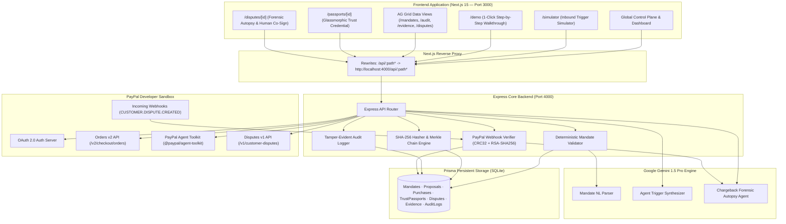

# Passport — Trust, Receipts & Dispute Defense for AI-Agent Payments

> **Institutional-grade spend governance, cryptographic proof-of-authorization, and automated chargeback defense for autonomous AI agent transactions.**

---

## 🌟 Executive Pitch

As autonomous AI agents acquire the authority to spend money—purchasing SaaS seats, booking client travel, ordering inventory, or spinning up cloud infrastructure—the financial ecosystem faces a critical governance gap:

1. **How do businesses guarantee an AI agent never hallucinates or exceeds authorized budgets?**
2. **When an autonomous charge is disputed, how does a merchant prove to PayPal that the transaction was legitimate, bounded, and delivered?**

**Passport** is the trust and defense infrastructure for the agentic economy. It provides:
- **Deterministic Spend Mandates**: Human-authored, code-enforced boundaries restricting purpose, budget caps, allowed vendor categories, and time-to-live.
- **Pre-Spend Policy Gates**: Every agent proposal is evaluated deterministically before payment execution. Out-of-bounds purchases (e.g. an unauthorized $120 chair when given an $80 gift card mandate) are rejected at the code level.
- **PayPal Orders v2 Settlement**: Authorized proposals are routed directly to PayPal Orders v2 for instant capture with **PayPal Seller Protection: ELIGIBLE**.
- **Cryptographic Trust Passports**: Every settled transaction mints an immutable, portable digital credential (`PASS-2026-XXXX`) containing SHA-256 Merkle hashes of the authorization, transaction receipt, agent inference reasoning, and merchant terms.
- **Autonomous Dispute Autopsy Room**: Incoming chargeback webhooks (`CUSTOMER.DISPUTE.CREATED`) trigger a **Google Gemini 1.5 Pro** forensic autopsy that analyzes claims, reconciles evidence, drafts a formal defense, and enforces **human co-signature** prior to PayPal submission.

---

## 🎯 The Core Problem

| Dimension | The Agentic Vulnerability | The Passport Solution |
| :--- | :--- | :--- |
| **Pre-Spend Risk** | LLMs hallucinate parameters, overspend corporate wallets, or stray into unauthorized merchant categories. | Deterministic, non-bypassable pre-spend validator gates proposals against human-signed mandates. |
| **Receipt Deficit** | Traditional card and PayPal receipts show *what* was billed, but zero proof of *why* an AI agent initiated it or *who* authorized it. | Immutable **Trust Passport** binds the mandate, model prompt, inference trace, and delivery receipts in a SHA-256 Merkle chain. |
| **Dispute Loss** | "Unauthorized transaction" chargebacks leave merchants defenseless against cardholders claiming an agent acted without consent. | Automated **Dispute Autopsy** proves prior authorization, seller protection eligibility, and digital fulfillment with human co-signature. |

---

## ⚙️ Tech Stack

- **Frontend**: [Next.js 15](https://nextjs.org/) (App Router, React 19, TypeScript, Tailwind CSS, Framer Motion)
- **Backend API**: [Node.js](https://nodejs.org/) & [Express](https://expressjs.com/) (REST API on port 4000 with byte-accurate raw request stream verification)
- **Data & ORM**: [Prisma ORM](https://www.prisma.io/) with zero-setup embedded SQLite database
- **AI Intelligence**: [Google Gemini 1.5 Pro](https://deepmind.google/technologies/gemini/) via `@google/generative-ai` (Natural-language mandate parsing, agent trigger simulation, and forensic chargeback autopsy)
- **Data Grids**: [AG Grid Community](https://www.ag-grid.com/) (`ag-grid-react`, `ag-grid-community`) with high-density PayPal Quartz theme
- **Payment & Agent Rails**:
  - **PayPal Orders v2 API**: `/v2/checkout/orders` (Intent, create, and capture)
  - **PayPal Agent Toolkit**: [`@paypal/agent-toolkit`](https://www.npmjs.com/package/@paypal/agent-toolkit) for autonomous agent wallet integration
  - **PayPal Disputes v1 API**: `/v1/customer-disputes` for claim management
  - **PayPal Webhooks**: Full cryptographic RSA-SHA256 signature verification & CRC-32 payload validation

---

## 🏛️ System Architecture



---

## 💳 PayPal Integration Details

Passport leverages PayPal's developer ecosystem across four dedicated integration points:

### 1. PayPal Orders v2 API (`/v2/checkout/orders`)
- **Order Creation**: Automatically configures digital purchase units with `capture` intent, currency code, line item detail, and custom requisition ID (`custom_id`).
- **Instant Order Capture**: Captures pre-authorized transactions, records `paypalCaptureId`, and extracts `sellerProtectionStatus` (`ELIGIBLE`).
- **Fallback Simulation**: If live sandbox credentials are omitted, the client smoothly falls back to sandbox simulation, guaranteeing zero broken demos.

### 2. PayPal Agent Toolkit (`@paypal/agent-toolkit`)
- Integrated into backend purchasing routines to model autonomous wallet interactions and programmatic agent settlement workflows.

### 3. PayPal Disputes v1 API (`/v1/customer-disputes`)
- Queries incoming dispute data and submits structured merchant evidence packages with cryptographic passport digests.

### 4. Cryptographic Webhook Signature Verification
Incoming PayPal webhooks are authenticated according to PayPal's official cryptographic specification:
1. **Header Extraction**: Reads `paypal-transmission-id`, `paypal-transmission-time`, `paypal-cert-url`, `paypal-auth-algo`, and `paypal-transmission-sig`.
2. **Byte-Accurate CRC-32 Checksum**: Uses Express `verify` middleware to retain raw request payload bytes. Calculates unsigned 32-bit CRC-32 checksum (`zlib.crc32(rawBody) >>> 0`).
3. **SSRF Defense**: Validates that `paypal-cert-url` uses HTTPS and strictly resolves to a valid `.paypal.com` host domain (`api.paypal.com` or `api.sandbox.paypal.com`).
4. **Certificate Caching**: Fetches the X.509 public key PEM certificate from PayPal and caches it in memory for 6 hours.
5. **RSA-SHA256 Verification**: Constructs the string `<transmissionId>|<transmissionTime>|<webhookId>|<crc32>` and validates the base64-encoded transmission signature using Node.js `crypto.createVerify("RSA-SHA256")`.
6. **Dual Fallback**: If local verification flags a signature issue in sandbox, queries PayPal's `/v1/notifications/verify-webhook-signature` REST endpoint as verification backup.

---

## 🚀 Setup & Installation Instructions

### Prerequisites
- **Node.js**: v18.0.0 or higher (v20+ recommended)
- **Package Manager**: `npm` or `pnpm`

---

### Step 1: Backend Setup

1. Open a terminal and navigate to `backend/`:
   ```bash
   cd backend
   ```

2. Install backend dependencies:
   ```bash
   npm install
   ```

3. Create your backend environment configuration:
   ```bash
   cp .env.example .env
   ```

   **Required `.env` values in `backend/.env`**:
   ```env
   # Server Configuration
   PORT=4000
   FRONTEND_URL=http://localhost:3000

   # Database (SQLite default)
   DATABASE_URL="file:./dev.db"

   # PayPal Sandbox Credentials (https://developer.paypal.com)
   PAYPAL_CLIENT_ID="your_sandbox_client_id"
   PAYPAL_CLIENT_SECRET="your_sandbox_client_secret"
   PAYPAL_ENVIRONMENT="sandbox"
   PAYPAL_WEBHOOK_ID="your_webhook_id"

   # Google Gemini API Key (https://aistudio.google.com)
   GEMINI_API_KEY="your_gemini_api_key"
   ```
   *(Note: If you leave `PAYPAL_CLIENT_ID` or `GEMINI_API_KEY` blank, Passport automatically activates high-fidelity sandbox simulation mode so all flows remain 100% functional for evaluation.)*

4. Initialize and seed the Prisma database:
   ```bash
   npm run prisma:generate
   npm run prisma:push
   npm run seed
   ```

5. Start the backend server:
   ```bash
   npm run dev
   ```
   *The backend will boot on `http://localhost:4000` (health check: `http://localhost:4000/health`).*

---

### Step 2: Frontend Setup

1. Open a second terminal and navigate to `frontend/`:
   ```bash
   cd frontend
   ```

2. Install frontend dependencies:
   ```bash
   npm install
   ```

3. Create your frontend environment configuration:
   ```bash
   cp .env.example .env.local
   ```

   **`.env.local` contents**:
   ```env
   NEXT_PUBLIC_APP_URL="http://localhost:3000"
   BACKEND_URL="http://localhost:4000"
   ```

4. Start the Next.js development server:
   ```bash
   npm run dev
   ```
   *The frontend will launch at `http://localhost:3000`.*

---

## 🧭 Application Walkthrough & Key Pages

| Route | Page Name | Core Functionality |
| :--- | :--- | :--- |
| **`/`** | **Fintech Landing Page** | Stripe/PayPal-inspired aesthetic presenting the problem, security model, and interactive live Trust Passport. |
| **`/simulator`** | **Agent Trigger Simulator** | Paste arbitrary support tickets or click pre-filled triggers ("Send Client Gift", "Office Chair", "Figma Renewal") to watch Gemini synthesize proposals against active mandates. |
| **`/dashboard`** | **Command Center** | High-level telemetry, live spend burn gauge, and settled transactions with instant dispute injection simulator. |
| **`/mandates`** | **Spend Mandates (AG Grid)** | Policy management grid displaying budget caps, category rules, and interactive "Create Mandate" modal with natural-language parsing. |
| **`/purchases`** | **Purchase Test Console** | Side-by-side verification of the Blocked ($120 chair) vs Approved ($75 gift card) scenarios with real-time rule checks. |
| **`/passports/[id]`** | **Trust Passport Credential** | Glassmorphic financial document with 5 tabs (Authorization, Settlement, Agent Trail, Receipt, Dispute Bundle), readiness gauge (98/100), and interactive **Verify Attestation Seal** scanner. |
| **`/disputes`** | **Dispute Room (AG Grid)** | Case table displaying active chargebacks, evidence ratios, deadlines, and direct entry into the Autopsy Room. |
| **`/disputes/[id]`** | **Dispute Autopsy Room** | Gemini claim classification, 5-point evidence checklist, automated defense letter, and **Human Co-Signature Modal** before submission. |
| **`/evidence`** | **Evidence Timeline (AG Grid)** | Chronological ledger of TLS session proofs, capture receipts, and agent traces with RFC 4180 CSV export. |
| **`/audit`** | **Merkle Audit Ledger (AG Grid)** | Cryptographic parent-hash chain with live 100% Merkle tree verification. |
| **`/demo`** | **Guided Demo Tour** | 1-click 8-step interactive narrative designed for presentation and evaluation. |

---

## 🏆 Hackathon Sponsor Prize Alignment

- **PayPal Ecosystem Integration**: End-to-end utilization of PayPal Orders v2 capture with seller protection, PayPal Disputes v1 evidence submission, `@paypal/agent-toolkit`, and cryptographic webhook signature verification with CRC-32.
- **AG Grid Integration**: Seamless implementation of AG Grid (`ag-grid-community` & `ag-grid-react`) across four primary operational surfaces (`/mandates`, `/disputes`, `/evidence`, `/audit`) with custom dark/light quartz theming, responsive flex columns, and custom cell renderers.
- **Google Gemini 1.5 Pro**: Deep agent integration for natural language mandate boundary creation, inbound ticket trigger parsing, and autonomous chargeback autopsy defense assembly.

---

## ⚖️ License
MIT License. Developed for the PayPal AI Hackathon 2026.
