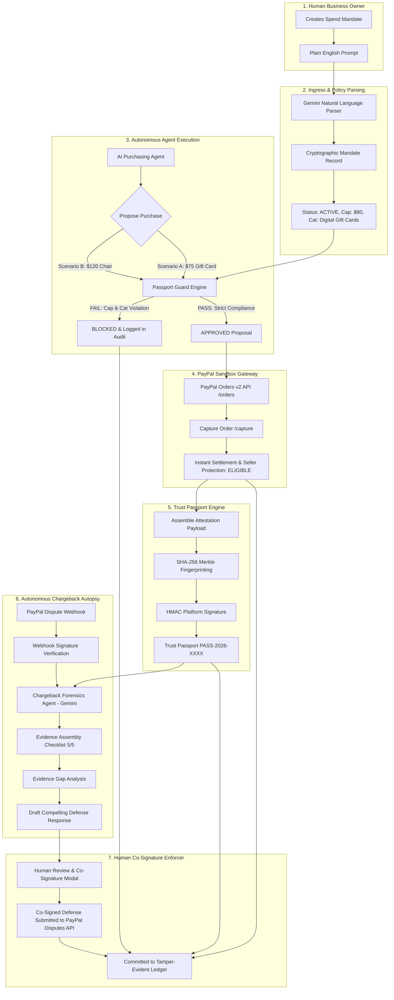

# Passport — System Architecture

> A trust, verifiable receipt, and dispute-defense layer for AI-agent purchases powered by PayPal Sandbox and Google Gemini.

---

## 1. High-Level Architecture Diagram

---

## 2. Core Subsystems

### A. Mandate Enforcement Engine (`server/mandates/validator.ts`)
- **Deterministic Bounding**: Validates proposals before any money-moving API is touched.
- **Constraints Enforced**:
  1. **Budget Cap**: `proposal.amount <= mandate.maxAmount` and cumulative spend limits.
  2. **Category Authorization**: Strict array/regex matching on allowed goods (e.g. `digital gift cards` vs `physical equipment`).
  3. **Time Boundary**: Verified against `mandate.expiresAt`.
  4. **Status Guard**: Only `ACTIVE` mandates permit execution.
- **Audit Commitment**: Every validation outcome (`VALIDATION_PASSED` or `VALIDATION_BLOCKED`) is hashed and recorded with the violation reasons.

### B. PayPal Sandbox Client (`server/paypal/`)
- **Orders API v2**:
  - `POST /v2/checkout/orders`: Creates standard capture orders with reference to the governing mandate ID.
  - `POST /v2/checkout/orders/{id}/capture`: Captures settled funds and evaluates PayPal Seller Protection eligibility.
- **Disputes API v1**:
  - `GET /v1/customer/disputes`: Retrieves live customer dispute records.
  - `POST /v1/customer/disputes/{id}/provide-evidence`: Submits structured proof of fulfillment and co-signed merchant defense.
- **Webhook Signature Verification**:
  - Verifies PayPal transmission headers (`PAYPAL-TRANSMISSION-ID`, `PAYPAL-CERT-URL`, `PAYPAL-TRANSMISSION-SIG`) using PayPal's `/v1/notifications/verify-webhook-signature`.
- **PayPal MCP Endpoint**:
  - Interfaces with the PayPal Agent Toolkit sandbox endpoint at `https://mcp.sandbox.paypal.com`.

### C. Trust Passport Credential (`server/verification/hasher.ts`)
- Each completed purchase generates a **Trust Passport**:
  - **SHA-256 Canonical Fingerprint**: Hashes mandate ID, purchase ID, PayPal order ID, amount, currency, recipient, and agent model into an immutable digest.
  - **HMAC / ECDSA Signature**: Platform cryptographic signature certifying authorization and non-repudiation.
  - **Dispute Readiness Score (0-100)**: Dynamically computed readiness grade based on attached verifiable evidence.

### D. Chargeback Autopsy (`server/agents/dispute-agent.ts`)
- Autonomous dispute forensic engine powered by **Google Gemini 1.5 Pro**:
  1. **Classification**: Evaluates claim reason (e.g. `UNAUTHORIZED_TRANSACTION`), dispute channel, and probability of merchant success.
  2. **Evidence Checklist**: Automatically pulls mandate record, PayPal capture receipt, agent chain-of-thought transcript, delivery confirmation, and terms of service.
  3. **Evidence Gap Analysis**: Flags any missing evidence items (e.g., recipient direct acknowledgment) and provides mitigations.
  4. **Defense Drafting**: Generates a formal merchant response to PayPal referencing the cryptographic Trust Passport.

### E. Human Co-Signature Enforcer
- **Strict Non-Autonomous Spending Boundary**: An AI agent cannot unilaterally settle disputes, submit formal legal defenses, or transfer funds.
- A verified human administrator must explicitly review the compiled evidence bundle and co-sign the payload prior to submission.

